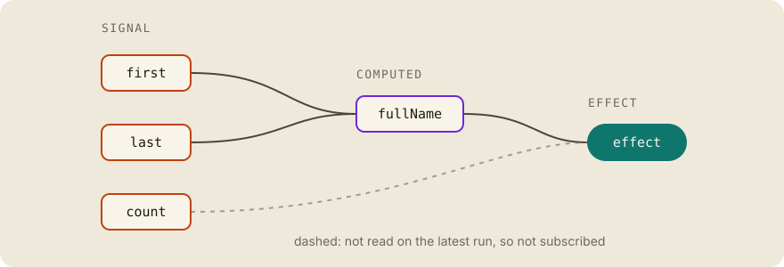

# NimbleJS

Small signals and state management for TypeScript, with no renderer attached.

[](https://www.npmjs.com/package/@onuracar-dev/nimblejs)
[](https://github.com/onuracar-dev/NimbleJs/actions/workflows/ci.yml)
[](./LICENSE)



**[Live playground](https://nimblejs.onuracar.dev/)**: the site runs the library source, so the effect counts you see there are real.

## What it is

NimbleJS is a reactive state layer: signals hold values, computed values derive from them, and
effects run when something they read changes. On top of that sit small stores with optional
undo/redo and persistence.

It does not render anything and the core never touches the DOM. That makes it usable in vanilla
JavaScript, Web Components, workers, or as the state layer under your own framework adapter.

> **Status:** pre-1.0. Good for experiments and small projects. The API may still change between
> minor versions, and there is no stability or performance guarantee yet.

## Install

```bash
npm install @onuracar-dev/nimblejs
```

Ships as ESM and CommonJS with type declarations. No runtime dependencies. Node 18 or newer.

## Quick start

```ts
import { computed, effect, signal } from '@onuracar-dev/nimblejs';

const count = signal(1);
const doubled = computed(() => count.value * 2);

const stop = effect(() => {
  console.log(`count=${count.value}, doubled=${doubled.value}`);
});
// logs: count=1, doubled=2

count.value = 5;
// logs: count=5, doubled=10

stop();
doubled.dispose();
```

Read with `.value`, write with `.value = ...`. That is the whole model.

## How updates run

**Dependencies follow the latest run.** An effect subscribes to exactly the signals it read the
last time it ran. If a branch stops reading a signal, changes to that signal stop waking the effect.

```ts
const name = signal('Ada');
const verbose = signal(false);
const count = signal(0);

effect(() => {
  console.log(name.value);
  if (verbose.value) console.log(count.value);
});

count.value = 1; // nothing runs: count was not read last time
```

**Cleanup is explicit.** If an effect returns a function, it runs before the next run and once
more when the effect is stopped.

```ts
const stop = effect(() => {
  const id = setInterval(tick, 1000);
  return () => clearInterval(id);
});

stop(); // final cleanup runs exactly once
```

**Batches settle before effects run.** `batch()` holds notifications until the outermost callback
returns, then runs each affected effect once. Nested batches flush at the outer boundary.

```ts
import { batch } from '@onuracar-dev/nimblejs';

batch(() => {
  first.value = 'Grace';
  last.value = 'Hopper';
}); // effects reading first and last run once, after both writes
```

**Computed values settle first.** When a write changes a computed value and also a signal an
effect reads directly, the computed value updates before the effect runs, so the effect sees
consistent values and runs once. (This was fixed after 0.2.0; see the [changelog](./CHANGELOG.md).)

**Equal writes are ignored.** Signals compare with `Object.is`, so writing the same value (or
`NaN` over `NaN`) notifies nobody.

**Schedulers are optional.** By default effects run synchronously. Pass a scheduler to hand the
run to a microtask, an animation frame, or your framework's queue:

```ts
effect(render, { scheduler: (run) => queueMicrotask(run) });
```

The scheduler owns de-duplication outside a `batch`.

## Stores, history and persistence

A store is a named record of signals. Each key becomes a signal under `store.state`.

```ts
import { createStore, persist, withHistory } from '@onuracar-dev/nimblejs';

const settings = createStore('settings', { theme: 'dark', sidebarOpen: true });

settings.state.theme.value = 'light';              // write one key
settings.setRawState({ theme: 'dark', sidebarOpen: false }); // write several, as one batch
settings.getRawState();                            // { theme: 'dark', sidebarOpen: false }

persist(settings, { storage: localStorage });
const history = withHistory(settings, { maxHistory: 25 });

history.undo();
history.redo();
history.dispose();
```

- `persist` loads saved state once, then writes JSON to the given `Storage` on every change.
  Without a `storage` option it uses `localStorage` and throws if none exists. Read, parse and
  write errors go to `onError` if you pass one, otherwise to `console.warn`.
- `withHistory` keeps bounded JSON snapshots (50 by default). Undo and redo are applied as one
  batch and are not recorded as new history.

## API

| Export | Signature | Purpose |
| --- | --- | --- |
| `signal` | `signal(initial)` → `Signal<T>` | Mutable value with `Object.is` equality |
| `computed` | `computed(fn)` → `Computed<T>` | Derived value; call `dispose()` to stop it |
| `effect` | `effect(fn, { scheduler? })` → `stop()` | Tracked side effect with optional cleanup |
| `batch` | `batch(fn)` → result of `fn` | Coalesce notifications across nested writes |
| `createStore` | `createStore(id, initial)` → `Store<T>` | Named record of signals with `getRawState` / `setRawState` |
| `persist` | `persist(store, { storage?, key?, onError? })` → `store` | Hydrate and save a store through `Storage` |
| `withHistory` | `withHistory(store, { maxHistory? })` → controller | `undo`, `redo`, `clear`, `dispose`, `canUndo`, `canRedo`, `length` |

## What it does not do

- Render components or diff the DOM.
- Encrypt, validate or migrate persisted state, or sync it across tabs.
- Snapshot circular or non-JSON values in history.
- Return a stop handle from `persist`; it saves for the lifetime of the store.
- Detect effects that keep re-triggering each other.

## Relation to FluxDOM

[FluxDOM](https://github.com/onuracar-dev/FluxDOM) is a separate compiler-first UI project with
its own signal runtime. The two share tested reactive semantics but do not depend on each other.
The reasoning is in [ADR-0001](./docs/adr/0001-fluxdom-and-nimblejs-boundary.md).

## Development

```bash
npm ci
npm test          # vitest
npm run build     # typecheck, library build, CJS types
npm run pack:check
```

The website lives in [`website/`](./website) and imports the library source directly:

```bash
npm --prefix website ci
npm --prefix website run dev
```

See [CONTRIBUTING.md](./CONTRIBUTING.md) and [SECURITY.md](./SECURITY.md).

## License

MIT © 2026 Onur Acar
